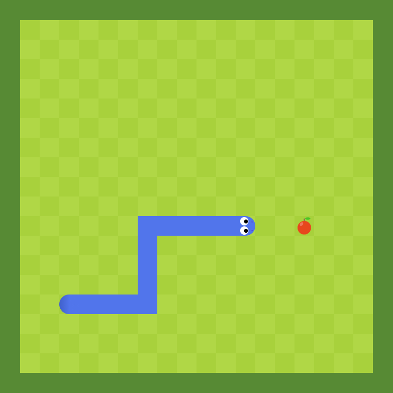

# Snake

A classic Snake game in plain JavaScript, HTML and CSS — no framework, no canvas: the board is a
20 × 20 grid of `
` cells redrawn on every tick.

**▶ Play it in your browser: <https://vollab0.github.io/Snake/>** (desktop, arrow keys)

Made in April 2025 for the *Digital Foundations* course during my exchange semester at SolBridge
International School of Business (South Korea). All the sprites (snake head, tail, apple) are my own.
`HelperLibrary.js` (grid helpers `ClearGrid`, `AddBlock`, `ChangeBlockColor`) was provided by the course,
and the menu illustration (`assets/gameover.jpeg`) is AI-generated.

## How it works

- The board is a 2D array (`W` wall, `.` empty, `S` body, `H` head, `T` tail, `A` apple) rendered into
  the grid by `DrawBoard()`, with a checkerboard background.
- The snake is a list of coordinates: each tick (`setInterval`, 200 ms) pushes a new head in the current
  direction and drops the tail, unless the snake has just eaten an apple, in which case it grows.
- The head and tail sprites are rotated with CSS transforms to follow the direction of movement.
- Apples appear on a random empty cell; hitting a wall or the snake's own body ends the game.

## Controls

Arrow keys. The snake cannot turn back on itself directly.

## Run locally

Open `index.html` in a browser — there is nothing to install or build.

## Known limitations

- Desktop only: fixed 800 × 800 px board and keyboard controls.
- No score display yet.
- Two arrow keys pressed within the same tick can still make the snake reverse into itself.
